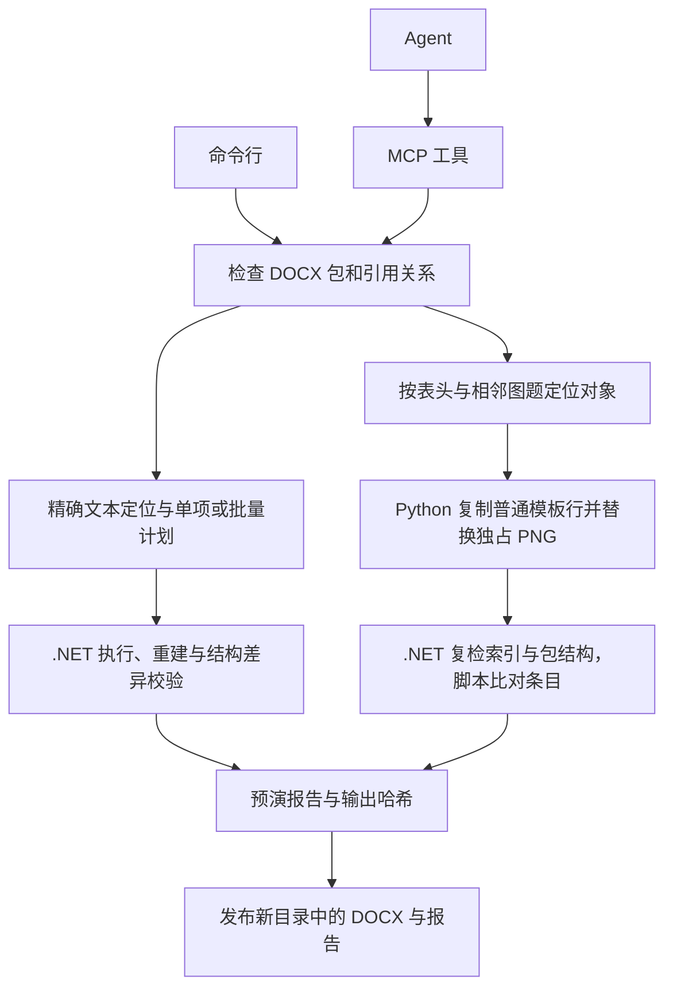

# DocxGuard 求职演示

从 README 的公开样例开始。原稿列有 North 和 West 两个站点，输出增加 South 的 42 个样本，图中同步增加第三条柱。演示数据由脚本生成，可在没有私人报告的电脑上复跑。

## 从用户意图到文件

## 面试时可以现场验证的三个问题

1. **如何知道改对了位置？** 打开模板，对照表头和图题运行 `table-figure list`。工具返回与这份源文件绑定的哈希、表格序号和图片引用。Day 24 的两轮评测展示了同一名称对应春秋两张图时如何消歧。
2. **预览之后改了数据会怎样？** 先运行 preview，记下输出哈希，再改请求中的数值，用旧哈希运行 apply。发布阶段重新构建，拒绝与预览不一致的结果。已有结果目录也不会被覆盖。
3. **如何证明保留了模板？** 在报告中检查 changed，再打开前后两个文件比较。公开样例只改变主文档和目标媒体条目。布局需要排版引擎另行验证；真实报告有一次 Word 导出前后均为 11 页的记录。

当前组合编辑支持 Transitional DOCX 的正文顶层表格，末行须为受支持的普通文本行；目标 PNG 必须独占引用并与新图像素尺寸一致。遇到合并单元格、共享图片或不匹配的预览哈希，可用项目评测说明解释拒绝原因。
